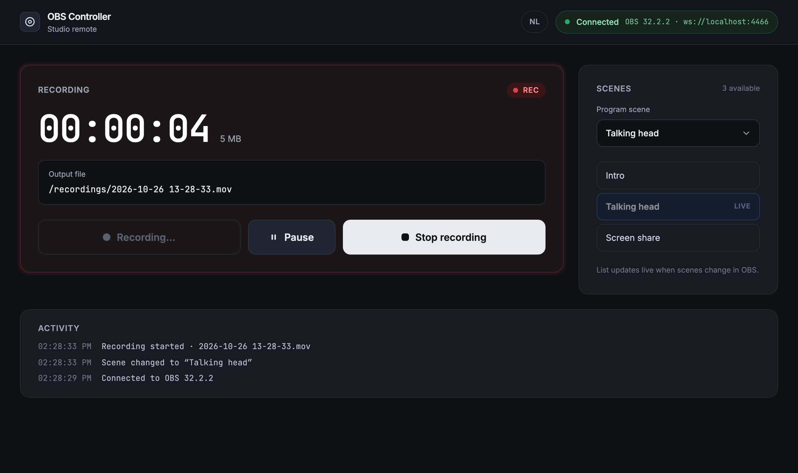

# OBS Controller

[](https://github.com/rednas16/CuezOBSController/actions/workflows/ci.yml)

A small web app that remote-controls [OBS Studio](https://obsproject.com): start, pause and stop
recordings, switch scenes, and watch the recording status update live from any browser on the
network. Built with SvelteKit (Svelte 5 runes), TypeScript and Tailwind CSS.



## Features

What the assignment asked for:

- **Start and stop recordings** from the browser
- **Switch scenes**, with a **dropdown of the scenes fetched from OBS** plus one-click buttons;
  the current scene is marked **LIVE**
- **Current recording file name** shown as soon as OBS reports it
- **Real-time updates**: timecode, file size, recording state and the scene list follow OBS live,
  also when you click in OBS itself (bonus)
- **Svelte 5 runes store** holding the OBS state for all components (bonus)
- **Dockerfile** and `docker compose` setup (bonus)
- Error handling and UI feedback: banner when OBS is unreachable or the password is wrong,
  toasts for rejected actions, buttons disabled based on the real state, automatic reconnect

Extras beyond the assignment:

- **Dutch and English interface** with a switch in the header, remembered per browser
- **Pause and resume** a recording (see the note under [API](#api) about OBS output settings)
- **Unit tests** (Vitest) for the server error mapping, formatting helpers, translations and the
  browser store
- **End-to-end tests** (Playwright) against a fake OBS, so they run without OBS and in CI
- **GitHub Actions CI**: lint, type-check, unit tests, build, e2e tests and Docker build on every push
- **Runs locally and in Docker from the same `.env`**: `npm run dev` for development with hot
  reload, `docker compose up` for a production build; both reach the same OBS
- Activity log of recent events, timecode in the browser tab title while recording, reduced-motion
  support, responsive layout for phones

## Assumptions

- **OBS runs on the same machine or the same network** as the app server. The server connects to
  OBS over its WebSocket API; the browser never talks to OBS directly.
- **One OBS instance, one program output.** Studio Mode preview and multiple canvases are out of
  scope.
- **A trusted network.** The app itself has no login; anyone who can open the page can control
  OBS. Put it behind authentication before exposing it beyond a studio LAN.
- **OBS Studio 28 or newer**, which ships obs-websocket protocol v5 (tested with OBS 32.2.2).
- **Recording settings live in OBS.** The app starts and stops whatever OBS is configured to
  record; format, folder and encoder are not managed here. Pausing requires an OBS output setting
  that supports it.
- **The file name is only known from OBS events.** If a recording was already running before the
  app connected, the name is shown as unknown rather than guessed.
- **Node.js 20 or newer** on the machine that runs the app; Docker is optional.
- **Scenes are identified by name**, as the OBS API does. Renaming a scene in OBS is handled by
  refreshing the list from the `SceneListChanged` event.
- The interface language follows the browser language on first visit (Dutch for `nl-*`, English
  otherwise) and can be changed at any time.

## Requirements

- Node.js 20 or newer (24 is used for development and in Docker)
- OBS Studio 28 or newer with the WebSocket server enabled

## Setup

1. In OBS: **Tools › WebSocket Server Settings**, tick _Enable WebSocket server_, click
   _Show Connect Info_ and copy the password. Click **OK**. Make sure you have at least two scenes.
2. In this folder:

   ```sh
   npm install
   cp .env.example .env     # paste the password into OBS_WS_PASSWORD
   npm run dev
   ```

3. Open http://localhost:5173. The badge at the top right turns green when the server reaches OBS.

If OBS runs on another computer, set `OBS_WS_URL=ws://<that-ip>:4455` in `.env`.

## Scripts

| Command            | What it does                                                        |
| ------------------ | ------------------------------------------------------------------- |
| `npm run dev`      | Start the dev server with hot reload                                |
| `npm run build`    | Production build (Node adapter); run it with `node build`           |
| `npm run check`    | Type-check Svelte and TypeScript                                    |
| `npm run lint`     | Prettier + ESLint                                                   |
| `npm test`         | Unit tests with Vitest                                              |
| `npm run test:e2e` | End-to-end tests with Playwright against a fake OBS (no OBS needed) |

## How it works

```
┌──────────────────────┐   HTTP (POST)    ┌───────────────────────────┐   WebSocket   ┌──────────────┐
│ Browser              │ ───────────────▶ │ SvelteKit server (Node)   │ ────────────▶ │ OBS Studio   │
│ Svelte 5 components  │                  │ /api/* routes             │               │ obs-websocket│
│ + one runes store    │ ◀─────────────── │ lib/server/obs.ts         │ ◀──────────── │ port 4455    │
└──────────────────────┘   SSE (events)   └───────────────────────────┘    events      └──────────────┘
```

- **The server owns the OBS connection.** [`src/lib/server/obs.ts`](src/lib/server/obs.ts) keeps
  one WebSocket to OBS, loads the initial state, listens to OBS events, polls the timecode once a
  second while recording, and reconnects with backoff when the connection drops. The password
  never leaves the server.
- **The API routes are thin.** Each file under [`src/routes/api`](src/routes/api) is a few lines
  that call one function of the OBS service and let a shared helper turn the result or error into
  JSON.
- **Live updates use Server-Sent Events.** [`/api/events`](src/routes/api/events/+server.ts) keeps
  an HTTP response open and pushes the full state snapshot whenever something changes. The browser
  uses the built-in `EventSource`, which reconnects by itself. SSE fits because the data flows one
  way; commands go through ordinary POST requests.
- **One store, many components.** [`src/lib/stores/obs.svelte.ts`](src/lib/stores/obs.svelte.ts)
  holds the snapshot in `$state` and exposes `$derived` flags such as `canStart` and `canStop`.
  Actions only call the API; the confirmed new state arrives over the stream. That is why the UI
  stays correct when someone presses record inside OBS.
- **Translations.** [`src/lib/i18n`](src/lib/i18n) is a 40-line rune-based translator with two
  dictionaries. Server log lines carry a machine-readable `kind` plus parameters, so the browser can
  render them in either language.

### Project structure

```
src/
  env.ts                    environment variables (validated at startup)
  hooks.server.ts           connects to OBS when the server boots
  lib/
    types.ts                types shared by server and browser
    format.ts               pure formatting helpers (+ tests)
    server/
      obs.ts                the OBS connection, state and actions
      api.ts                helpers that keep the routes short
      errors.ts             ObsError with HTTP status mapping (+ tests)
      config.ts, logger.ts
    stores/obs.svelte.ts    browser store with runes (+ tests)
    i18n/                   en.ts, nl.ts, index.svelte.ts (+ tests)
    components/             Header, ConnectionBanner, RecordingCard, ScenesPanel, ActivityLog, Toast
  routes/
    +page.svelte            composes the components
    api/                    status, events, scenes, scenes/current, recording/{start,pause,resume,stop}
e2e/
  fake-obs.mjs              a fake OBS speaking the obs-websocket v5 protocol
  app.spec.ts               Playwright tests
```

## API

| Method | Path                    | What it does                                        |
| ------ | ----------------------- | --------------------------------------------------- |
| GET    | `/api/status`           | Full snapshot: connection, recording, scenes, log   |
| GET    | `/api/events`           | Server-Sent Events stream: live state and log lines |
| GET    | `/api/scenes`           | Scene names and the current program scene           |
| POST   | `/api/scenes/current`   | Switch scene. Body: `{ "sceneName": "Intro" }`      |
| POST   | `/api/recording/start`  | Start recording                                     |
| POST   | `/api/recording/pause`  | Pause the recording                                 |
| POST   | `/api/recording/resume` | Resume a paused recording                           |
| POST   | `/api/recording/stop`   | Stop recording. Answers with the saved file's path  |

Errors come back as `{ "error": { "code", "message" } }` with a fitting HTTP status: 400 for a bad
request or unknown scene, 409 when the action clashes with the current state (`ALREADY_RECORDING`,
`NOT_RECORDING`, …), 501 `PAUSE_UNSUPPORTED`, 503 `NOT_CONNECTED`, 502 for other OBS errors. The
UI translates the codes into messages.

Example:

```sh
curl -X POST localhost:5173/api/scenes/current -H 'content-type: application/json' -d '{"sceneName":"Intro"}'
```

## Edge cases handled

- **OBS not running or wrong password**: red banner with the reason, controls disabled, automatic
  reconnect (1 s, 2 s, 4 s, 8 s, then every 15 s).
- **Connection lost mid-session**: same banner; the state is refreshed when OBS is back.
- **Recording started in OBS before the app connected**: OBS only reports the file name in its
  events, so the UI says the name is unknown instead of showing a wrong one.
- **Double actions** (start while recording, stop while idle): rejected with 409 and a toast; the
  buttons are disabled based on the real state anyway.
- **Scene removed or renamed in OBS while the page is open**: the list updates live; switching to a
  scene that no longer exists answers `UNKNOWN_SCENE`.
- **Pause is not supported by the OBS output settings**: OBS silently ignores the pause when
  _Recording Quality_ is "Same as stream". The server checks what really happened and answers
  `PAUSE_UNSUPPORTED` with instructions.
- **Opening the app via an IP address or in Docker**: requests are sent as JSON so SvelteKit's
  CSRF protection does not block them.

## Tests

- **Unit tests** (`npm test`, Vitest): error mapping, formatting helpers, the two dictionaries
  having the same keys and placeholders, and the browser store (with a fake `fetch` and
  `EventSource`).
- **End-to-end tests** (`npm run test:e2e`, Playwright): the production build runs in Chromium
  against [`e2e/fake-obs.mjs`](e2e/fake-obs.mjs), a small server that speaks the obs-websocket v5
  protocol in both JSON and msgpack. Its message shapes were captured from a real OBS 32.2.2 session
  ([`e2e/fixtures/obs-capture.json`](e2e/fixtures/obs-capture.json)). The tests cover the
  connection, scene switching via button and dropdown, start/stop recording, a scene created in OBS
  appearing live, a lost connection and its recovery, and the language switch. No OBS needed, so
  they run in CI on every push.

## Run with Docker

OBS keeps running on your own machine; only the web app runs in the container.

```sh
cp .env.example .env       # fill in OBS_WS_PASSWORD
docker compose up --build
```

Open http://localhost:3000 (or `http://<your-ip>:3000` from a phone on the same network).

Inside the container the app uses `OBS_WS_URL_DOCKER` from `.env` (default
`ws://host.docker.internal:4455`, which is how a container reaches the machine that runs Docker).
`OBS_WS_URL` stays `localhost` for `npm run dev`, so both ways of running work from the same `.env`.

Deploying the app to a remote server works the same way, but that server must be able to reach
OBS: OBS sits behind your router, so you would need a tunnel (Cloudflare Tunnel, Tailscale, …) or
port forwarding. For a studio setup, running the app on the OBS machine or in the same LAN is the
simpler choice.

## Design decisions

- **SvelteKit 3** is what `npx sv create` scaffolds today. Compared to most online examples this
  means `#lib/...` imports instead of `$lib`, environment variables declared in `src/env.ts`, and
  `$app/env` instead of `$app/environment`.
- **SSE instead of WebSockets to the browser**: one-way data, native browser reconnect, and a plain
  `+server.ts` route; no extra server needed. WebSockets are still used between the server and OBS
  because that is OBS's protocol.
- **Full snapshots over the stream** rather than fine-grained patches: the state is tiny and it
  removes a whole class of "UI drifted from reality" bugs.
- **Server-side state checks before calling OBS** (for example "is there a recording to stop?") so
  errors are explicit and translatable rather than opaque OBS error codes.
- **No UI library**: Tailwind with a handful of design tokens in `layout.css`; the components stay
  readable and the palette lives in one place.
- **A fake OBS for tests** instead of mocking the client library, so the tests exercise the real
  protocol code paths and can also run in CI.

## Ideas for a next version

Kept out of scope on purpose; the code is laid out so each one is a small addition.

- Live preview image of the program output (`GetSourceScreenshot`)
- Streaming start/stop with bitrate and dropped frames
- Studio Mode: pick a preview scene and press _Transition_
- Audio: mute/unmute and live meters per source
- Show/hide sources inside a scene (lower thirds), edit text sources
- Replay buffer, virtual camera, transitions and durations
- Authentication in front of the app when exposed beyond a trusted network
